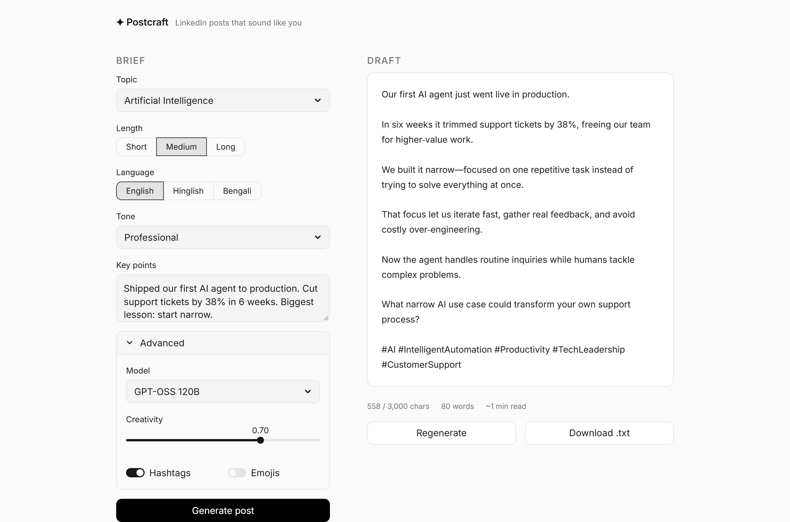
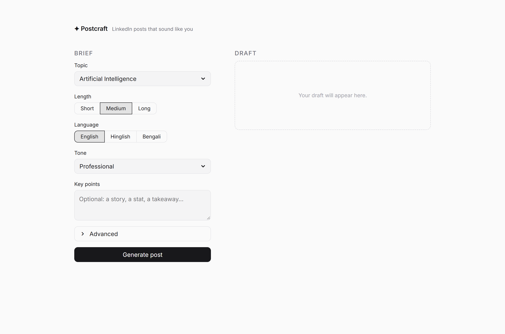
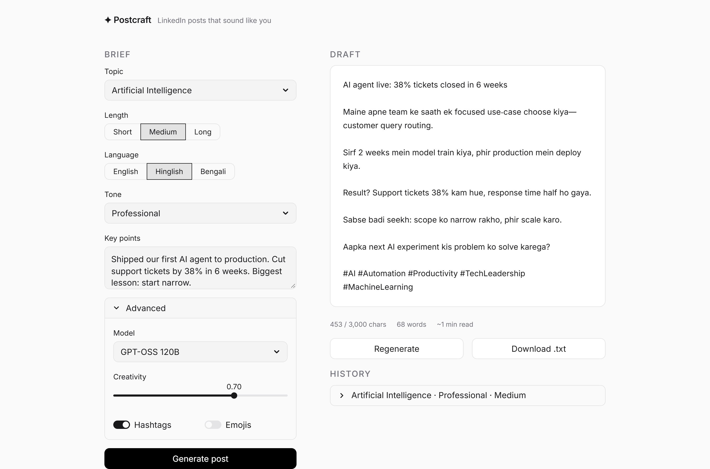

<div align="center">

# Postcraft

**LinkedIn posts that sound like you.**

Turn a topic and a few key points into a ready-to-publish LinkedIn post in seconds, styled after real high-performing posts.




</div>

## Overview

Postcraft is a focused writing tool for LinkedIn. You describe what you want to say, and it streams back a polished draft with a strong hook, scannable structure and a clear call to action. Every generation is grounded in a curated set of real posts, selected by topic, language, length and engagement, so the output reads like something a person would actually publish.

## Features

| | |
|---|---|
| **Streaming generation** | Drafts appear word by word on Groq's low-latency inference. |
| **Style matching** | Few-shot examples ranked by topic, language, length and engagement. |
| **Multilingual** | English, Hinglish (Latin script) and Bengali (native script). |
| **Fine control** | Tone, length, key points, creativity, hashtags and emojis. |
| **Publish-ready checks** | Live character count against LinkedIn's 3,000 limit, word count and read time. |
| **Workflow** | One-click copy, download, regenerate and session history. |
| **Token-efficient prompts** | Compact system prompt, capped examples and low reasoning effort. |

## Screenshots

<table>
  <tr>
    <td width="50%"></td>
    <td width="50%"></td>
  </tr>
  <tr>
    <td align="center"><sub>Compose a brief</sub></td>
    <td align="center"><sub>Hinglish output with session history</sub></td>
  </tr>
</table>

## Quick start

Requires Python 3.11+ and a free [Groq API key](https://console.groq.com/keys).

```bash
git clone <repo-url> postcraft && cd postcraft
python -m venv venv
venv\Scripts\activate            # macOS / Linux: source venv/bin/activate
pip install -r requirements.txt
cp .env.example .env             # then set GROQ_CLOUD_API_KEY
streamlit run src/main.py
```

Open http://localhost:8501.

> Run from the project root so the theme in `.streamlit/config.toml` is applied.

## Configuration

| Variable | Required | Description |
|---|---|---|
| `GROQ_CLOUD_API_KEY` | Yes | Groq API key, read from `.env`, the environment or Streamlit Secrets. |

If no key is configured, the app asks for one and keeps it for the current session only.

Models, lengths, languages and tones live in [`src/config.py`](src/config.py).

## How it works

```
Brief ──> examples.pick() ──> prompts.build() ──> Groq (streaming) ──> Draft
          top 2 matching       compact system +
          posts, trimmed       key:value request
```

1. **Select.** Posts tagged with the chosen topic are ranked by language, length and engagement. The top two, trimmed to 1,200 characters, become style references.
2. **Prompt.** A short system prompt sets the rules for hook, structure, banned clichés and the closing question. The request is sent as terse `key: value` lines to keep input tokens low.
3. **Generate.** The response streams into the UI, is normalized, and is saved to session history.

## Project structure

```
.
├── .streamlit/config.toml   theme
├── data/
│   ├── raw-post.json        source posts
│   └── processed-post.json  tagged dataset used for few-shot
├── docs/images/             screenshots
└── src/
    ├── main.py              Streamlit UI
    ├── generator.py         streaming generation
    ├── prompts.py           system prompt and request builder
    ├── examples.py          few-shot selection
    ├── llm.py               Groq client
    ├── config.py            models, lengths, languages, tones
    ├── preprocess.py        raw posts to tagged dataset
    └── styles.css           UI styles
```

## Extending the dataset

Better examples produce better posts. Add posts to `data/raw-post.json`:

```json
[{ "text": "Post body...", "engagement": 420 }]
```

Then rebuild the tagged dataset:

```bash
python src/preprocess.py
```

The script extracts line count, language and tags for each post, merges similar tags into a canonical set, and writes `data/processed-post.json`. New topics appear in the app automatically.

## Deployment

**Streamlit Community Cloud.** Point the app at `src/main.py` and add `GROQ_CLOUD_API_KEY` under *Settings > Secrets*.

**Dev Containers / Codespaces.** The included `.devcontainer` installs dependencies and starts the app on port 8501.
